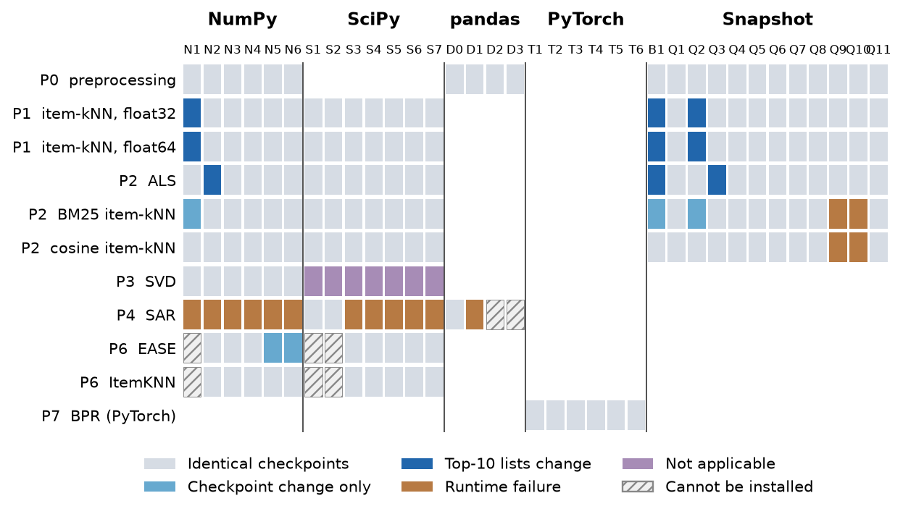
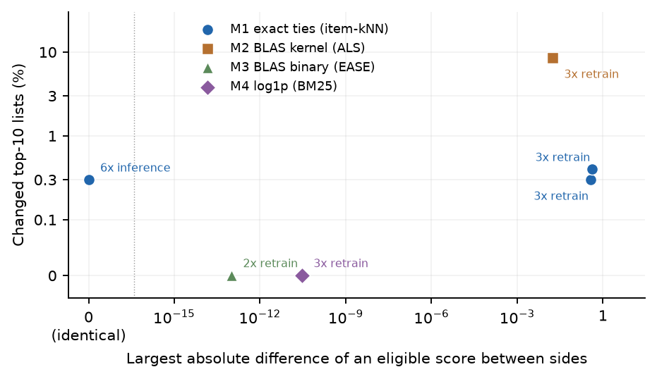
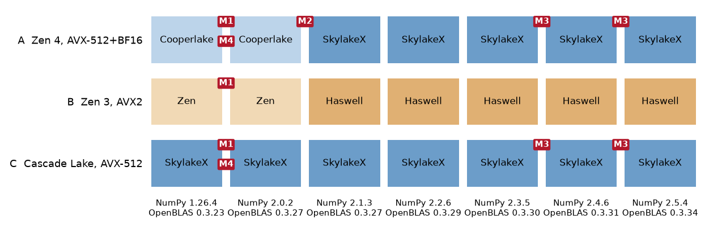
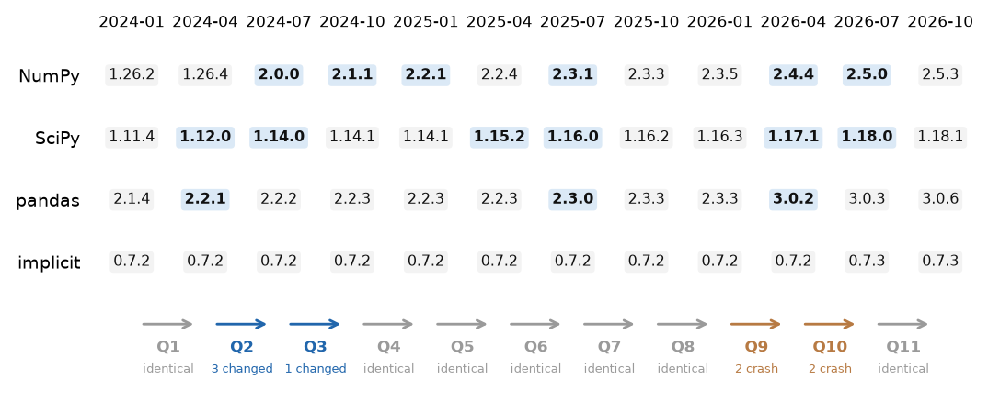
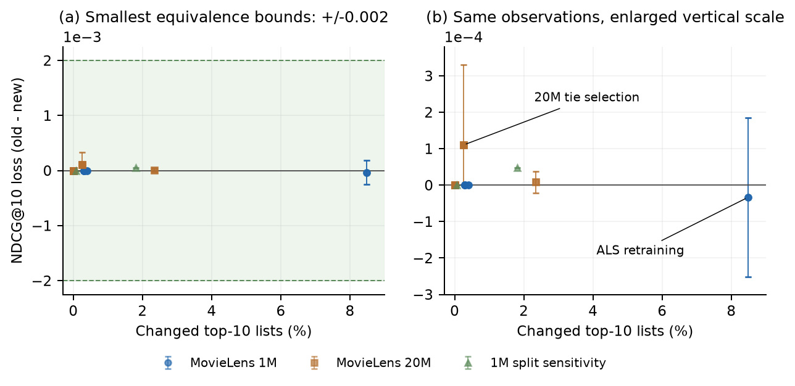
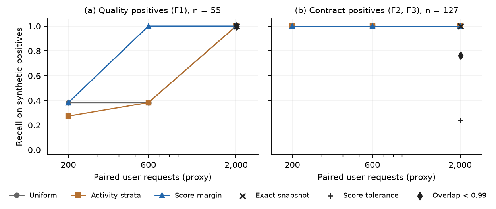
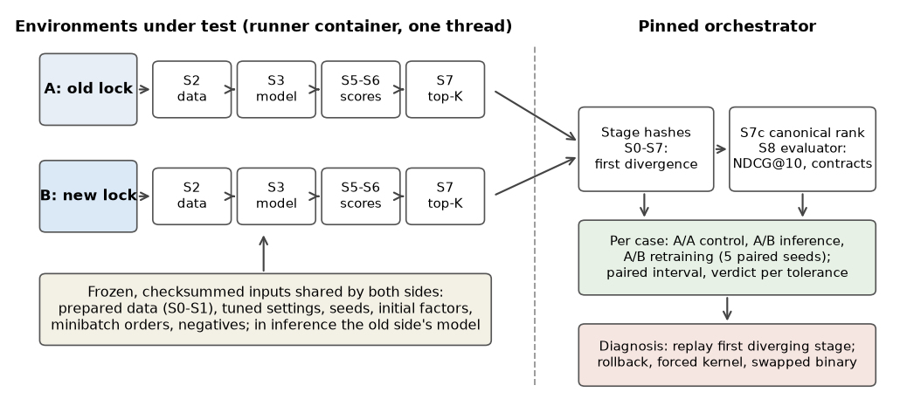

# Silent Ranking Changes Under Dependency Upgrades

Code, protocols and paper sources for **Silent Ranking Changes Under Dependency Upgrades in MovieLens Recommender Pipelines** by Samrand M. Hassan ([ORCID 0000-0001-6694-159X](https://orcid.org/0000-0001-6694-159X)).

Paper: [`paper/silent-ranking.pdf`](paper/silent-ranking.pdf)

Upgrading NumPy, SciPy, pandas or PyTorch can change what a recommender returns while it keeps running without an error. This study upgrades those libraries under fixed recommender pipelines and asks four separate questions of every upgrade:

1. Did a recorded checkpoint (data, model, scores, ranked list) change?
2. Did a user's top-10 list change?
3. Did the output break a contract (seen items, valid IDs, finite scores)?
4. Did offline ranking quality (NDCG@10) get measurably worse?

A different list is not necessarily a worse list, so these are reported separately.

## Key results

The primary study covers **201 cases**: 35 upgrade transitions applied to eleven pipeline configurations on MovieLens 1M, each run with a same-environment control, frozen-model inference and paired-seed retraining.

| Outcome | Cases |
|---|---:|
| Identical checkpoints on both sides | 164 |
| A checkpoint changed silently | 14 |
| &nbsp;&nbsp;of which a top-10 list changed | 9 |
| Visible runtime failure (crash) | 16 |
| Not applicable (pipeline does not call the upgraded package) | 7 |
| Quality regression or contract violation | **0** |

- The 14 silent changes occur in 7 of the 35 transitions, all involving NumPy.
- Every completed comparison is equivalent within the declared NDCG@10 margins of 0.002, 0.005 and 0.010. The largest point loss in the study is 0.00011 (MovieLens 20M).
- The upgrades that broke a pipeline did so visibly: removed NumPy aliases (`np.NaN`, `np.in1d`) and a `pandas<3` cap.


*Every primary case: one cell per transition and pipeline. Dark blue cells changed a top-10 list, light blue cells changed only a model or scores, brown cells crashed.*

## Four mechanisms

Each silent change traces to one of four mechanisms, each tested by a controlled intervention:

| | Mechanism | Evidence | Effect |
|---|---|---|---|
| M1 | NumPy 2.0's unstable `argpartition`/`argsort` reorders exactly tied scores | replay on frozen scores, rollback and reapplication | 0.3–0.4% of users get a different list; no quality change |
| M2 | The OpenBLAS bundled in the NumPy wheel switches kernel family (Cooperlake → SkylakeX) | forcing `OPENBLAS_CORETYPE=SkylakeX` in the old environment reproduces the upgraded ALS model bit for bit (seed 17) | 8.5% of users get a different ALS list; no quality change |
| M3 | OpenBLAS 0.3.31 in the NumPy 2.4.6 wheel changes the EASE matrix inverse | swapping the bundled binary in both directions moves the model with it | coefficients differ by 1.3e-15; no list change |
| M4 | NumPy 2.0's `log1p` differs in the last bit | substituting the old `log1p` values restores the old BM25 weights | weights change; no list change |

A GPU extension (PyTorch 2.9.1 → 2.10.0 on a Tesla T4) adds one training difference whose cause is unresolved.


*The size of a numerical difference does not predict whether lists change: exact ties change lists with identical scores, while differences of 1e-13 to 1e-11 change none.*

## The same wheel behaves differently on different processors

The mechanism cases were repeated on three CPUs. Only M1 appears on all of them. M2 appears only where OpenBLAS switches from Cooperlake to SkylakeX kernels; M3 and M4 appear on both AVX-512 CPUs and not on the AVX2 CPU. A second run of all rented-host cases reproduced 6,780 of 6,780 checkpoint digests.


*Kernel family selected by the OpenBLAS bundled in each NumPy wheel on each CPU host. Red labels mark the mechanisms that changed a checkpoint on that host.*

## Unpinned projects meet these changes on every install

The snapshot collection resolves unpinned requirements at quarterly cutoffs from January 2024 to October 2026, which is what an unpinned project would have installed on each date.


*Q2 crosses NumPy 2.0 and Q3 crosses NumPy 2.1. The April 2026 snapshot pairs `implicit` 0.7.2 with NumPy 2.4.4, which crashes, so Q9 and Q10 fail.*

## List churn is not quality loss


*Every completed comparison, with its 95% interval, against the smallest equivalence margin (left) and at a finer scale (right).*

## Which inexpensive check separates churn from harm?

No real upgrade was harmful, so detectors were evaluated on synthetic faults injected into real outputs (182 positives at δ = 0.005: 55 quality faults and 127 contract faults).

- Contract checks caught every contract fault, even with 100 users.
- The pre-specified 300-user activity panel caught 21 of 55 quality faults.
- A 300-user panel chosen at the ranking boundary caught all 55, but also alarmed on 3 of 97 no-fault controls.
- Exact-output and strict-overlap checks caught every fault but also alarmed on benign upgrades and on 90 of 97 no-fault controls.


*Recall against the number of paired user requests, for quality faults (a) and contract faults (b).*

## Study design


*Both sides of a transition run the same pipeline on frozen, checksummed inputs inside locked environments. A separately pinned orchestrator hashes the checkpoints, evaluates quality and contracts, and compares the sides.*

- **Environments:** one locked `uv` environment per side, built in a Linux container pinned by image digest, Python 3.12, one thread.
- **Pipelines:** pandas preprocessing, a reference item-kNN (float32 and float64), `implicit` ALS, cosine and BM25, Surprise SVD, Recommenders SAR, Cornac EASE and ItemKNN, and a reference PyTorch BPR.
- **Data:** MovieLens 1M (primary) and MovieLens 20M (scale check), full-catalogue evaluation, binary relevance at rating ≥ 4.
- **Statistics:** paired-user bootstrap (inference) and paired-seed t intervals (retraining); a case is equivalent only if its 95% interval lies inside ±δ.
- **Protocols:** frozen by git tag before the held-out runs; see [`protocol/`](protocol/).

## Getting started

Requirements: [uv](https://docs.astral.sh/uv/) (installs Python 3.12) and Docker.

```
uv sync
uv run pytest
uv run silentrank init
uv run silentrank case list
```

Prepare MovieLens 1M (downloaded from GroupLens and checked against the pinned checksum), build and screen the environments, and run one case:

```
uv run --locked python data/prepare_ml1m.py
uv run --locked silentrank env screen-pilot all
uv run --locked silentrank run --case N1-P1-float32
uv run --locked silentrank compare --case N1-P1-float32
uv run --locked silentrank verdict --case N1-P1-float32
```

`run` tunes on baseline validation data, requires a bit-identical same-environment inference control, then runs A/B inference and paired-seed retraining. Results go to `results/` (not in git): a DuckDB ledger, run artifacts and per-user metrics.

Other commands:

```
uv run silentrank diagnose --case N1-P1-float32
uv run silentrank probes
uv run python -m silentrank.detect.synthetic_v2      # synthetic positive controls
uv run silentrank report pilot
```

The paper's tables, figures and numbers are generated from a results ledger by `paper/scripts/make_tables.py`, `make_figures.py` and `make_extras.py`. The manuscript builds with the TeX Live image (see the comment at the top of `paper/main.tex`).

## Repository layout

```
protocol/             frozen protocols (v0, v1), pipeline and host declarations, probe policy
protocol/cases/       case manifests: systematic transitions and issue-guided leads
protocol/reproducers/ minimal reproducers for the mechanisms
envs/<env_id>/        one locked environment under test per folder (pyproject.toml + uv.lock)
docker/               runner image (base pinned by digest) and cloud job scripts
data/                 dataset download and preparation scripts, checksum manifests
src/silentrank/
  orchestrator/       environment builder, container runner, ledger, comparisons
  worker/             code that runs inside an environment under test
  evaluator/          metrics, canonical ranking, contracts
  stats/              paired intervals and verdicts
  detect/             probe panels and synthetic controls
  cli.py              `silentrank` command
tests/                pytest suite
paper/                manuscript sources, generated tables and figures, generator scripts
```

## Rules

The code and protocols follow these rules; docstrings refer to them by number.

**Evidence and claims**
1. Report only results produced by logged runs.
2. Record failures (resolve, build, import, crash, timeout) in the ledger. Never skip silently, never delete or overwrite a run; re-runs get a new `repeat` index.
3. Keep the outcome categories separate: install or runtime failure, behavioural change, quality regression, contract violation, uncertain.
4. "Silent" means execution completed and no configured failure signal fired. Always state the library's own test-suite status (passed, failed, unavailable, not runnable).
5. A different ranking is not a worse ranking. Harm needs independent relevance or contract evidence, with uncertainty.
6. Real cases, unresolved effects and synthetic faults are reported in separate tables. Systematic and issue-guided collections are never pooled.
7. The unit of independence is the upgrade case or family and the mechanism, not user rows.
8. Lack of statistical significance never produces a pass.

**Protocol**
9. Protocols are frozen by git tag before results are inspected. Changes after a freeze need a new version and a written reason.
10. Pilot transitions are development cases and are never reported as held-out evaluation.
11. Hyperparameters are tuned only in the baseline environment on validation data, then frozen.

**Engineering**
12. Experiment runs happen only inside the runner container, never in Windows-native Python.
13. `src/silentrank/worker/` runs inside environments under test: it may import only the standard library, NumPy, SciPy and the library under test, and exchanges `.npy`/`.npz` and JSON.
14. The evaluator and statistics run in the pinned orchestrator environment (root `pyproject.toml`), never inside an environment under test.
15. One host per comparison: runs with different `host_id` are never compared.
16. Ledger writers open, write and close quickly; DuckDB allows one writer or many readers.

**Operations**
17. Credentials and sign-ins (for example `hf auth login`) are entered by the researcher only.
18. Anything that spends money, such as a cloud job, needs the researcher's explicit go for that launch, with hardware, time limit and estimated cost.
19. Nothing is published or posted to upstream projects without the researcher's explicit go.
20. Datasets are not redistributed; only download and preparation scripts are.

## Data

MovieLens 1M and 20M are provided by [GroupLens](https://grouplens.org/datasets/movielens/) under their research-use terms and are not included. The preparation scripts download them and verify the published checksums.

## Citation

If you use this code, please cite the paper:

```
Samrand M. Hassan. Silent Ranking Changes Under Dependency Upgrades in MovieLens
Recommender Pipelines. Manuscript, 2026.
https://github.com/samrand96/recsys-dependency-upgrades
```
